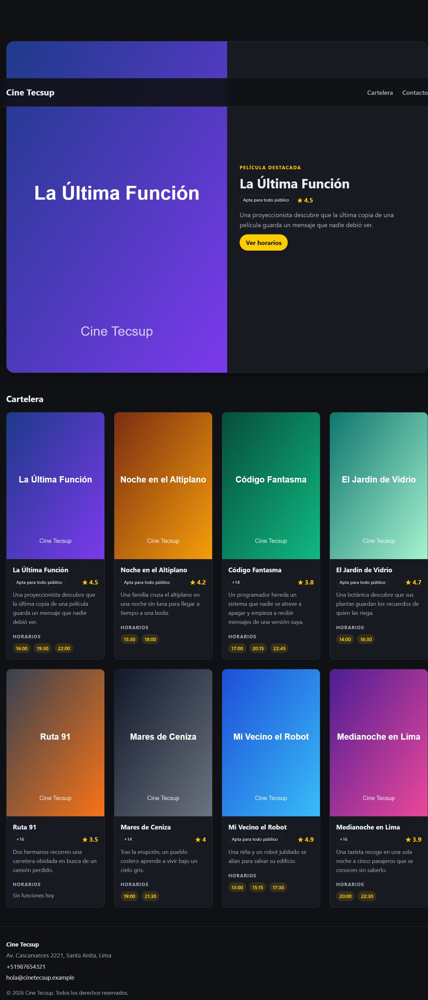

# Semana 09 — Cartelera de cine con React y Vite

Laboratorio oficial de la semana 09 del curso **Desarrollo de Aplicaciones Empresariales (DAE)**.
Aplicación de una sola página que muestra la cartelera de un cine, construida con React + Vite y
organizada por responsabilidades (componentes, datos y estilos).

## Vista previa



## Descripción

La interfaz muestra:

- Un **Header** con el nombre del cine y la navegación principal.
- Un **Hero** con la película destacada (imagen, sinopsis, clasificación, valoración y botón a sus horarios).
- Una **cartelera** con 8 películas; cada **MovieCard** muestra imagen, título, clasificación, valoración,
  sinopsis y horarios. La película *Ruta 91* no tiene funciones y muestra el mensaje «Sin funciones hoy».
- Un **Footer** con dirección, teléfono, correo y aviso de copyright.

## Tecnologías y dependencias

| Paquete | Versión |
|---|---|
| Node.js | v24.15.0 |
| npm | 11.12.1 |
| react | ^19.3.1 |
| react-dom | ^19.3.1 |
| vite | ^8.3.6 |
| @vitejs/plugin-react | ^6.1.2 |
| oxlint | ^1.90.0 |

## Puesta en marcha

```bash
npm install     # instala las dependencias
npm run dev     # servidor de desarrollo en http://localhost:5173
npm run build   # compila la versión de producción en dist/
npm run preview # sirve la versión compilada
npm run lint    # revisa el código con oxlint
```

## Estructura del proyecto

```
seman09/
├── index.html
├── package.json
├── vite.config.js
├── public/
│   └── posters/            # 8 pósters SVG (1.svg … 8.svg)
└── src/
    ├── main.jsx            # punto de entrada; importa la arquitectura CSS
    ├── App.jsx             # compone Header + Hero + MovieList + Footer
    ├── components/
    │   ├── Header.jsx
    │   ├── Footer.jsx
    │   ├── Hero.jsx
    │   ├── MovieCard.jsx
    │   └── MovieList.jsx
    ├── data/
    │   └── movies.js       # 8 películas + contact + links
    └── styles/
        ├── variables.css   # colores, espacios, radios, sombras y layout
        ├── base.css        # reset y estilos base del documento
        ├── layout.css      # header, main, footer y contenedores
        ├── components.css  # navegación, hero, tarjetas, horarios y botón
        └── index.css       # importa los cuatro archivos en orden
```

## Componentes y responsabilidad

| Componente | Props | Responsabilidad |
|---|---|---|
| `Header` | `name`, `links` | Encabezado con `<h1>` y navegación (`<nav aria-label="Principal">`). |
| `Hero` | `movie` | Banner de la película destacada con enlace a `#horarios-<id>`. |
| `MovieCard` | `movie` | Tarjeta de una película: imagen, título, clasificación, valoración, sinopsis y horarios. |
| `MovieList` | `movies` | Recorre el arreglo con `map` y dibuja una tarjeta por película con `key={movie.id}`. |
| `Footer` | `contact` | Pie de página con dirección, enlace `tel:` y enlace `mailto:`. |

Los hijos no saben de dónde vienen los datos: solo reciben por props lo que necesitan.
`App.jsx` es el único que importa el archivo de datos y reparte la información.

## Arquitectura de CSS

El CSS se divide en capas con una responsabilidad cada una y se importa desde un único punto
(`src/styles/index.css`) para respetar el orden de la cascada:

1. **`variables.css`** — custom properties (`--color-*`, `--space-*`, `--radius-*`, `--shadow`, `--container`).
   Es la única fuente de verdad de la paleta y las medidas.
2. **`base.css`** — reset mínimo (`box-sizing`, márgenes, listas, imágenes) y estilos del `body`.
3. **`layout.css`** — estructura de la página: `.site-header`, `.main`, `.site-footer` y contenedores.
4. **`components.css`** — apariencia de navegación, hero, botón, tarjetas, insignias y horarios.
5. **`index.css`** — importa las cuatro capas anteriores en ese orden.

Los nombres de clase siguen la convención tipo BEM (`bloque__elemento`), por ejemplo
`.movie-card__title` o `.site-header__inner`.

## Los tres errores provocados y su mensaje

Durante el desarrollo se provocaron a propósito los tres errores típicos pedidos en la guía.
Los mensajes se copiaron tal como aparecieron en la consola del navegador o en la terminal.

### 1. Usar `class` en lugar de `className`

Se cambió `<header className="site-header">` por `<header class="site-header">`.

```
Invalid DOM property `class`. Did you mean `className`?
```

React trata `class` como un atributo desconocido del DOM y avisa en la consola.

### 2. Olvidar la `key` en el `map`

Se quitó `key={movie.id}` del `<li>` que genera `MovieList`.

```
Each child in a list should have a unique "key" prop.

Check the render method of `MovieList`.
```

Sin `key`, React no puede identificar cada elemento de la lista y lo advierte en la consola.

### 3. Devolver dos nodos raíz sin fragmento

Se quitaron las etiquetas `<>` y `</>` que envolvían el `return` de `App.jsx`.

```
Adjacent JSX elements must be wrapped in an enclosing tag.
Help: Did you want a JSX fragment `<>...</>`?
```

JSX exige un único nodo raíz; para devolver varios hermanos hace falta un fragmento.

## Observaciones

1. **La estructura importa:** separar componentes, datos y estilos hizo que cada archivo tuviera una sola
   razón para cambiar y que el proyecto fuera fácil de leer.
2. **Props mínimas:** cada hijo recibe solo lo que usa. `MovieCard` no sabe si la película viene de un
   archivo, de una API o de un estado; solo recibe `movie`.
3. **`key` estable:** usar `movie.id` en lugar del índice evita que React reutilice nodos equivocados
   cuando la lista cambia de orden.
4. **Array vacío es *truthy*:** para detectar «sin funciones» hay que comparar `showtimes.length === 0`,
   no `!showtimes`.
5. **CSS por capas:** las variables permiten cambiar toda la paleta desde un solo archivo y el orden de
   importación evita que los estilos base pisen a los componentes.
6. **Accesibilidad:** se usan roles semánticos (`header`, `nav`, `main`, `article`, `footer`), `alt` en las
   imágenes, `aria-labelledby` en las secciones y `aria-label` en la navegación.
7. **Sin errores en consola:** al final la aplicación compila (`npm run build`), pasa el linter
   (`npm run lint`) y carga sin advertencias de React.

## Conclusiones

1. Aprendí a crear un proyecto de React con Vite, instalar sus dependencias y levantarlo con `npm run dev`.
2. Comprendí cómo dividir una interfaz en componentes funcionales pequeños y componerlos en `App.jsx`.
3. Verifiqué que las props son el canal correcto para pasar datos del padre a los hijos.
4. Entendí el valor de una arquitectura CSS ordenada por capas y con variables reutilizables.
5. Reconocí los mensajes de error más comunes de JSX y cómo corregirlos sin adivinar.
